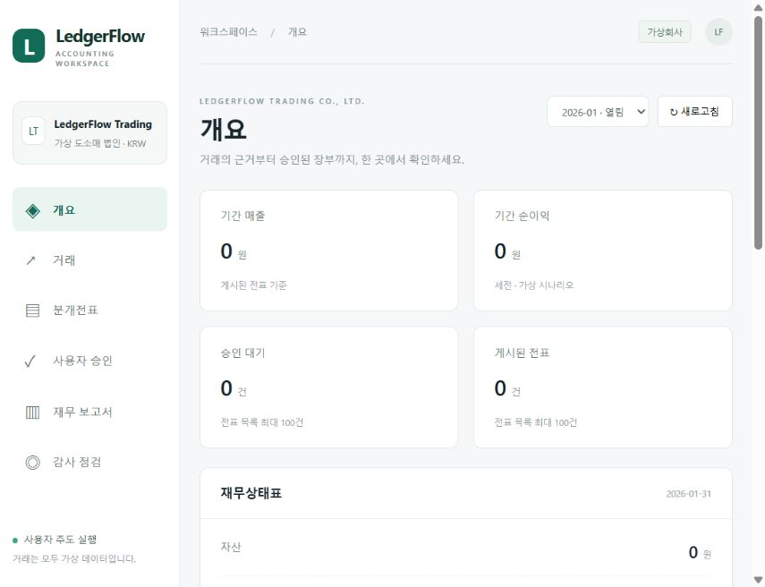

# LedgerFlow AI

공개 저장소: [osh3772-star/ledgerflow-ai](https://github.com/osh3772-star/ledgerflow-ai)

[](https://github.com/osh3772-star/ledgerflow-ai/actions/workflows/ci.yml)

한국 가상 도소매 법인의 회계 자동화 포트폴리오다. Claude Code와 Codex가 **단일 foreground MCP 서버**를 공유하고 앱의 6역할 agent·skill로 사용자 요청을 수행한다. 유료 LLM API·자체 오케스트레이터·무인 스케줄러를 사용하지 않는다.

**ERP 1,000건 → 결정론적 분개 → 독립 검증 → 인간 화면 승인 → 원자적 전기 → 원장·시산표·BS/IS**를 구현했다. 결산 수정분개·역분개·기간 마감·반려 전표 폐기·은행 대사, 무료 공공 API 4종의 11개 도구, Astro React 대시보드를 포함한다. MCP 도구는 41개다.

**처음 사용한다면 [사용 안내](docs/USER_GUIDE.md)부터 읽으세요.** API 연결 상태표, 현재 Mock/Live 구분, 사용 순서, 앱에 복사할 요청문, 사용자 승인과 자동화 범위를 한 문서로 정리했다.

현재 공공 API 4종은 실제 응답 검증 이력이 있으며 기본 시연은 `mock`다. 로컬 DB/MCP는 동작하고 Supabase는 DB 인증 오류로 보류 중이다. 앱에서 업무를 요청하고 웹에서 직접 승인한 뒤 앱에 전기를 요청한다.

## 실행

Node 24, pnpm 11.25.

```powershell
pnpm install --frozen-lockfile
pnpm start
```

화면: `http://127.0.0.1:8787/`. 두 앱 MCP: `http://127.0.0.1:8787/mcp`. 프로젝트 `.mcp.json`과 `.codex/config.toml`이 같은 endpoint를 사용한다. 앱 신뢰/허용 설정 후 재로드한다. 서버 종료는 `stop` + Enter.

`pnpm start`는 웹을 build하고 단일 로컬 demo 서버를 연다. `.env.local`의 Supabase 설정을 보존하면서 이 프로세스에는 폐기형 demo DB를 명시적으로 선택한다. 추가 로그인/클라우드 설정 없이 실행하며, 종료하면 DB가 정리되고 다음 실행에 같은 합성 1,000건으로 재생성된다. 지속 장부의 `pnpm mcp:start`/postgres 경로와 기존 안전 검사는 유지한다. [시연 순서와 완료 범위](docs/PORTFOLIO_READY.md), [연결·stdio·인간 승인·DB 설정](docs/CLIENT_SETUP.md).

서버 실행 후 다른 터미널에서 `pnpm mcp:doctor`로 두 앱 설정·현재 Codex 등록·MCP 41개 도구·회사 범위 읽기를 점검한다. 결과는 `.ledgerflow/readiness/latest.json`에 저장하며 실제 앱 추론과 인간 승인은 별도로 확인한다.

남은 일은 [사용자/Codex 담당표](docs/WORK_ASSIGNMENTS.md)에 나눴다. `pnpm deploy:check`가 계정·도구·설정의 준비 여부와 담당자를 출력한다. [Docker·CI 실행 및 검증 범위](docs/DEPLOYMENT.md)를 참고한다.

사용자 준비를 Aside AI로 진행할 때는 [한 번에 하나씩 전달하는 명령](docs/ASIDE_TASKS.md)을 사용한다. 외부 인증 DB의 선택적 [암호화 세션 저장](docs/SECURITY_SESSIONS.md)도 제공하며 기본 로컬 demo는 로그인 없이 유지한다.

기존 Supabase 연결을 준비할 때는 [단계별 설정](docs/SUPABASE_SETUP.md)에 따라 세 연결값만 먼저 입력한다. `pnpm supabase:check`가 TLS·Auth health·DB schema metadata를 읽기 전용으로 점검하며, 자동 migration/seed·사용자 인증·Storage 검증을 수행한 것으로 표시하지 않는다.

초기 schema 설치의 `pnpm supabase:init`도 기본은 읽기 계획이다. `--offline`은 로컬 migration manifest만 생성하고, 명시적인 `--apply --project=... --hash=...`만 빈 namespace에 6개 원본 migration을 한 트랜잭션으로 적용한다. 실제 Auth 사용자·ERP hosted 적재·서버 profile 전환은 후속 단계다.

## 키와 인간 승인

키는 루트 ignored `.env.local`에 둔다. 새 checkout은 `.env.example`을 복사한다.

```dotenv
ADAPTER_MODE=mock
NTS_SERVICE_KEY=
DART_API_KEY=
LAW_OC=
ECOS_API_KEY=
```

공공 API 실조회는 `ADAPTER_MODE=live`, 명시 진단은 `pnpm api:check` / `pnpm api:adapters`다. API 실패를 mock 성공으로 바꾸지 않는다. `pnpm env:check`는 설정 여부만 출력한다.

로컬 데모에는 로그인이나 비밀번호 설정이 없다. 전표·증빙을 검토하고 화면에서 승인 또는 반려 버튼을 누른다. 앱은 승인 요청을 만들며 앱의 tool 실행 허용은 장부 승인이 아니다.

## 구현 / 검증

| 구현 | 증거 |
| --- | --- |
| 고정 ERP 1,000건 + 격리회사 1건, 원본 migration 001~003 보존 | fixture SHA·실제 PostgreSQL RLS/FK/CHECK/UNIQUE 테스트 |
| Decimal 복식부기·10종 거래·원장·시산표·BS/IS | 수기 gold + 합성 오류 데이터셋, LLM 독립 |
| 인간 승인·hash/version·원자적 전기·불변성 | 승인 우회/권한 철회/라인 변조/중복/마감 테스트 |
| 상각·선급 결산·역분개·폐기·은행 대사 | 월 완결 마감 및 실제 DB 통합 테스트 |
| 4 공공 API Adapter / 11 MCP 도구 | 전체 mock, 일부 live 실키, 캐시·장애 테스트 |
| 단일 MCP HTTP/stdio, 두 앱 설정 / 각 6역할 | 두 SDK 연결·공유 Draft·정적 config/skill 검사 |
| 연결 자가진단·기존 PostgreSQL profile | 읽기 연결·현재 Codex 등록, Draft 재기동 보존·미완성 schema 거절 |
| Astro React 화면, Supabase Auth/Storage 연결 코드·정책 | 정적 build·브라우저 검토, JWT adapter 테스트 |
| Windows/Linux CI + Linux Docker 이미지 | [최신 실행](https://github.com/osh3772-star/ledgerflow-ai/actions/runs/38849513756)에서 각 OS 211 tests, 실제 이미지 내부 비관리자 MCP 41개 도구·회사 범위 조회 |

최종 테스트 수·평가 수치와 live 조회 범위는 [IMPLEMENTATION_STATUS.md](docs/IMPLEMENTATION_STATUS.md)에 기록한다. [실제 GitHub CI](docs/CI_VALIDATION.md)는 Windows/Linux 회귀 검사와 Linux Docker 이미지 smoke를 통과했다. 실제 Claude Code/Codex 앱 추론, hosted Supabase Auth/Storage, 원격/Cloudflare 배포는 외부 수용 검증이 남아 있다.

로컬 및 Windows/Linux CI에서 **211개 테스트 / 30개 파일**이 통과했다. 고정 가상 ERP 1,000건의 Draft 생성·분류 평가, 수기 분개 10/10, 합성 오류 5/5 탐지를 확인했다. 프로젝트 유료 모델 API 호출은 0회다.



## 설계와 한계

[전체 아키텍처·ERD·운영비](docs/ARCHITECTURE.md), [개발 계획·평가](docs/IMPLEMENTATION_PLAN.md), [MCP 전체 명세](docs/MCP_TOOLS.md), [native 역할 계약](docs/CLIENT_ROLES.md).

매출 인도·단일 수행의무·일정 단위원가·월 상각 등 합성 시나리오 정책에 한정한다. 완전한 K-IFRS 준수, 실제 기업 정확도, 법인세/법정 신고·현금흐름표·주석을 제공한다고 주장하지 않는다. 공공 자료는 참고자료이며 가상회사 장부에 섞지 않는다. `auth-bootstrap.sql`은 native DB 테스트 전용이며 Supabase에 적용하지 않는다.

Cloudflare에는 현재 Node/native DB backend를 배포하지 않는다. Astro 정적 사이트 가능성과 전체 회계 서버의 런타임 호환성은 별개로 검증한다. 로컬 호스팅/모델 API 추가비용은 0이고 기존 앱 구독 한도와 외부 DB 비용은 별도다.
