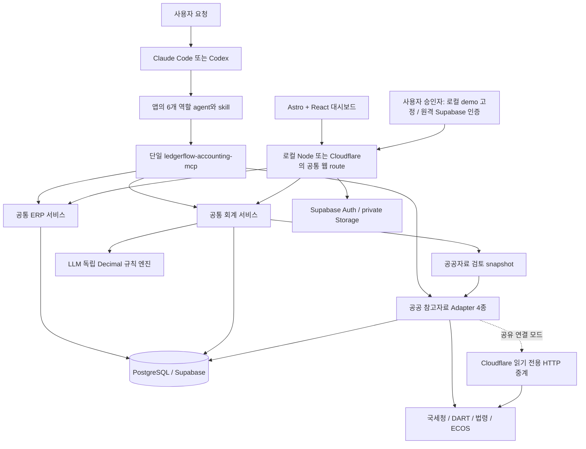
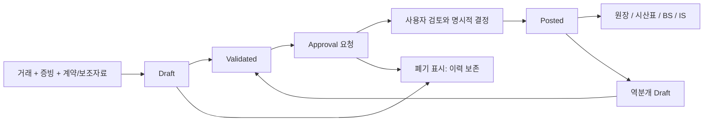
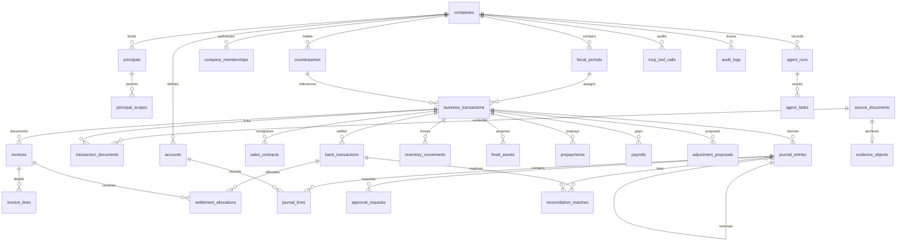

# LedgerFlow architecture

> 2026-10-18 최신 시작 방식: 현재 폴더에 비파괴적으로 역할/규칙을 병합하고, 공유 서버에서 24시간 임시 회사와 1,000건을 자동 발급한다. OAuth 없는 MCP 초기화와 비공개 guest 헤더를 지원한다. 009는 회사별 guest scope와 전표별 인간 웹 승인 티켓을 추가하며 기존 001~008은 수정하지 않는다. Google은 보관을 선택할 때만 연결한다. [현재 실행 지침](START_HERE.md) · [세션/승인/용량 경계](REMOTE_USAGE.md). 아래 Google 로그인 설명은 보관한 개인 장부에 해당한다.

> 2026-10-17: 기존 서버 팩토리·41개 도구를 Cloudflare HTTP에 재사용하는 OAuth, 계정별 회사/ERP, 서비스 작성자와 인간 승인자 분리를 추가했다. 실제 Supabase 접속·TLS·Auth health 검사가 성공했으며 운영 상태와 실제 앱 검증 범위는 [원격 구조·검증 경계](REMOTE_USAGE.md)를 따른다. 새 MCP 제품이나 추론 runner는 없다.

방문자 로그인은 Google → Supabase 서버 PKCE → 기존 암호화 브라우저 세션이다. 이메일·비밀번호 입력과 원격 password/signup 경로는 종료했다. 008은 쿠키 해시와 결합한 10분 단일 사용 암호화 login flow만 추가하며 기존 001~007과 회계 엔진을 변경하지 않는다. 실제 Google 제공자 등록은 [운영 설정](GOOGLE_LOGIN_SETUP.md)을 따른다.

2026-10-16 현재 구현을 설명한다. 이전 Phase 기록은 당시 결과이며 현재 기능 목록은 이 문서와 MCP 카탈로그를 기준으로 한다.

## 실행 구조

LedgerFlow Trading Co., Ltd.는 국내 도소매 가상 법인, KRW 기능통화, 1월~12월 회계연도다. ERP 거래·세금계산서·은행 자료는 모두 합성 데이터다. K-IFRS를 목표로 한 제한된 회계 정책을 구현하며 전문가 검토나 완전한 준수 인증을 주장하지 않는다.

MCP 서버 제품은 정확히 하나다. 기본 foreground 프로세스의 `http://127.0.0.1:8787/mcp`를 두 앱이 공유한다. 선택 stdio도 같은 서버 팩토리·서비스를 사용하며 한 프로세스가 HTTP 승인 화면과 stdio를 함께 제공한다. 별도 오케스트레이터·모델 API·무인 스케줄러는 없다. 사용자가 앱에서 작업을 요청하고 앱 종료/중단 시 실행도 중단된다.

2026-10-16 공공자료의 회계 근거 첨부와 선택 Cloudflare 공유 중계를 추가했고, 10-17 동일 Worker에 인증된 원격 MCP·개인 장부 경로를 추가했다. `/v1/query`는 공공 도구 11종의 별도 HTTP 중계이며 MCP 서버가 아니다. `/mcp`는 기존 단일 MCP 팩토리를 재사용한다. 직접 mock/live와 gateway 모드는 같은 `PublicDataClient` 계약을 사용한다. 서버가 공공 클라이언트 인스턴스와 캐시를 회계·웹·MCP 도구에 재사용한다. 기존 마이그레이션·fixture·분개 금액 엔진을 교체하지 않는다. [연결·배포 명세](REMOTE_USAGE.md)

`get_accounting_source`와 신규 분개는 `AccountingReferenceService`로 DART 재무 참고, 거래일 법령, ECOS 금리 참고를 수집한다. 실사업자 매핑이 없는 합성 거래처는 국세청 자동 조회에서 제외한다. 개별 실패는 명시하고 수집 전체 기한은 18초로 제한한다. 새 전표 JSONB의 선택 필드 `publicReferences`를 기존 hash에 포함해 승인 대상을 고정한다. 이 필드에는 기본값을 부여하지 않아 기존 payload/hash를 보존한다. 참조자료가 금액·계정을 변경하지 않으며 AI는 그 적합성과 불확실성을 설명한다. 승인·검증·전기는 기존 독립 DB 제어를 따른다.

## 모듈과 의존성

| 위치 | 책임 |
| --- | --- |
| `packages/contracts` | Zod 입력·전표·역할 Result, UUID/date/원 단위 문자열 |
| `packages/test-data` | 고정 시드 `20261014`, 1,000건 ERP와 격리회사 1건, SHA manifest |
| `packages/accounting-core` | 계정 매핑·복식부기·검증·상각·시산표, DB/LLM 의존성 없음 |
| `packages/data-access` | 회사별 scope/RLS, parameter query, typed DB RPC, 원장·API 캐시 |
| `packages/application-services` | ERP와 회계 업무 서비스, MCP/웹 공통 재사용 |
| `packages/public-data` | 국세청·DART·법령·ECOS schema/normalize/cache/retry |
| `apps/mcp-server` | SDK v2 도구 registry, HTTP/stdio, MCP 인증, 인간 인증 route, Storage |
| `apps/web` | Astro 정적 출력 + React 화면, 동일 출처 API 호출 |
| `apps/public-api-gateway` | 선택 Cloudflare HTTP 중계, 4기관 키 서버 보관·인증·지역 호출 제한·Cache API; MCP 아님 |
| `scripts/prepare-public-site.ts` | 별도 임시 fixture DB의 공통 서비스 조회 결과를 공개 허용 목록으로 내보냄. 사용자 장부 접근·승인·전기 없음 |
| `apps/public-api-gateway/src/public-site.ts` | 생성된 합성 자료만 조회하는 공개 웹 API. 인간 세션·변경 요청 차단. 실제 장부 backend와 별도 |
| `scripts/check-connections.ts` | 기존 서버·두 앱 설정/현재 Codex 등록의 읽기 진단, 추론/승인/전기 없음 |
| `scripts/database-readiness.ts` | 기존 PostgreSQL의 필수 schema 읽기 점검, 자동 migration/seed 없음 |
| `scripts/postgres-connection.ts` | 지속 runtime/진단 공통 연결 설정, Supabase TLS CA·hostname 검증과 선택 CA 파일 |
| `scripts/check-supabase.ts` / `supabase-readiness.ts` | 명시적 Auth health·read-only catalog 진단, 비밀값 없는 결과와 연결/schema 준비 상태 분리 |
| `scripts/initialize-supabase.ts` / `supabase-initialization.ts` | 최초 설치 전용, 기본 읽기 계획·명시적 project/hash 적용, 원본 6개 migration의 원자적 적용·private receipt; Auth/ERP/전표 적재 없음 |
| `scripts/check-deployment.ts` | 계정·도구·설정의 존재와 담당자별 후속 작업 출력, 비밀값/장부 변경 없음 |
| `scripts/container-smoke.ts` | 소유한 폐기형 DB/mock의 foreground MCP 프로토콜 검사, 승인/전기 없음 |
| `apps/mcp-server/src/*human-session*` | memory/선택적 PostgreSQL 세션, JWT/CSRF 암호화·토큰 해시·회사별 AAD, 승인 권한과 분리 |
| `.agents/skills` / `.claude/skills` | 동기화된 역할별 업무 지침 |
| `.codex/agents` / `.claude/agents` | 앱 native 역할 정의, 서버/모델 runner 없음 |

서버 SDK `@modelcontextprotocol/server@2.3.1`와 Hono bridge `2.1.5`, 검증 클라이언트 SDK `2.3.1`을 고정했다. 웹은 Astro `7.3.8`, React integration `7.0.1`, React `19.3.0`다. Node `24`를 사용한다. 공식 v2 명세와 설치 패키지를 확인했다. [MCP SDK v2](https://ts.sdk.modelcontextprotocol.io/v2/)

실행 profile은 폐기 가능한 native PostgreSQL `demo`와 사용자가 준비한 기존 DB의 `postgres`다. `postgres`는 기존 자료·권한을 초기화하지 않으며 필수 테이블/RPC/전표 컬럼을 확인한 뒤 회사 scope를 검사한다. 초기화 실패 시 pool을 닫고, 정상 종료 후 재기동해도 기존 DB의 Draft와 hash를 그대로 조회한다. 인간 승인은 이 profile에서 외부 검증 JWT가 필요하다. 로컬 demo의 로그인 없는 고정 운영자를 기존 DB에 적용하지 않는다.

Supabase 연결은 [단계별 설정](SUPABASE_SETUP.md)으로 준비한다. 이 PC의 Session pooler/5432 문자열은 Connect 화면에서 가져오며 지역명으로 host를 추측하지 않는다. hosted 연결의 URI SSL 옵션이 명시적 검증 설정을 덮어쓰지 못하게 분리하고 `rejectUnauthorized: true`와 hostname 검증을 유지한다. `supabase:check`는 키를 서버 측에서만 사용하며 Auth health와 DB catalog만 읽는다. 사용자 JWT·Storage·장부 운영 검증과 연결 성공을 구분하며 migration/seed는 자동 수행하지 않는다. 실제 연결 진행 상태는 [검증 기록](IMPLEMENTATION_STATUS.md)에 별도로 남긴다.

`pnpm mcp:doctor`는 status/context → catalog → 회사 범위 거래 최대 1건 순서의 SDK 검증이다. 서버를 추가로 띄우거나 모델 추론을 실행하지 않는다. 두 앱의 프로젝트 설정, Codex CLI 등록, 실제 프로토콜 읽기, 실제 앱의 추론 수용 테스트를 구분해서 기록하며 마지막 항목은 자가진단으로 증명하지 않는다.

Docker/Compose는 같은 제품을 일반 OS 사용자로 기동하고 loopback 경계를 유지한다. health check는 프로세스 상태만 읽고, foreground smoke는 독립 테스트 DB/mock에서 실제 도구 읽기를 검증한다. GitHub CI에는 Windows/Linux 회귀 후 이미지 내부 smoke를 작성했다. Docker와 Linux 실행 결과가 없는 상태에서는 파일 작성/Windows 실행과 구분한다. [배포 경계](DEPLOYMENT.md), [담당 작업](WORK_ASSIGNMENTS.md)

인간 세션은 기본 memory이며 외부 JWT를 사용하는 기존 DB profile에서 PostgreSQL 저장을 선택할 수 있다. 006의 private/RLS 테이블에는 토큰 해시와 AES-GCM 암호문을 저장하고 서버 전용 키로 복원한다. 회사/토큰 해시가 AAD에 연결되고, 재기동 후에도 provider의 JWT 검증과 독립 승인 검사를 반복한다. 기존 로그인 없는 demo·회계 전표 흐름·41개 MCP 도구는 유지한다. 원격 OAuth/HTTPS는 이 기능으로 완료되지 않는다. [설계와 테스트](SECURITY_SESSIONS.md)

## 전표와 데이터 흐름

Draft는 결정론적 규칙으로만 생성한다. AI가 임의 전표 라인을 DB에 넣는 도구는 제공하지 않는다. 계약 인도일·단일 수행의무·재고 단위원가 등 지원 정책을 확인할 수 없으면 `NEEDS_REVIEW`로 중단한다. 판단이 필요한 근거 기준서·가정·불확실성을 전표와 역할 Result에 남긴다.

금액은 입력/출력에서 문자열, 코드에서 Decimal, DB에서 정확한 numeric이다. 차대변 합계·유효 계정·원천 거래·증빙 ID와 hash·기간·중복을 독립 엔진과 DB가 검사한다. DB가 JSONB payload의 SHA-256을 생성한다. 승인은 journal ID/version/hash와 다른 인간 신원에 연결되고 전기 시 권한을 다시 확인한다. 정규화된 journal_lines와 승인 payload도 대조한다.

전기 RPC는 row/period lock, 회사별 UNIQUE, 원자적 트랜잭션을 사용한다. 게시 전표/라인은 불변이다. ERP 상태를 강제로 바꾸지 않고 Posted source 존재 여부로 미전기 거래를 산출한다. 동일 키 재요청은 같은 전표를 반환한다. 반려/미게시 전표는 이유와 hash로 폐기 표시할 수 있고 새 키로 대체 Draft를 만든다. 승인된 전표와 Posted는 폐기할 수 없다. 역분개는 원전표 링크와 반대 라인으로 별도 승인받는다.

월 결산은 자산·선급 스케줄에서 기게시 상각과 잔액 상한을 반영한 차액 Draft를 생성한다. 모든 원천 거래·수정분개가 게시되어야 기간을 마감하며 DB에서도 결산 금액을 다시 검사한다. BS는 누적 원장, IS는 조회기간 원장으로 작성한다. 손익의 자본 반영은 보고서 집계이며 이익잉여금 대체 전표까지 구현한 것은 아니다. 법인세 산출·현금흐름표·자본변동표·주석·법정 신고는 현재 범위에 없다.

은행 대사는 ERP 은행 누적 이동액과 게시 현금 계정 `1010`를 별도로 제시하고 세금계산서 배분 잔액을 반환한다. 연결 RPC는 같은 원천 거래, 날짜, 방향, 금액의 게시 현금 전표만 허용한다. 미전기·역분개·시점 차이는 검토 대상이다. 실제 은행 API 연동은 없다.

## 공공 참고자료 API

공식 상세 조사/이용조건은 [PUBLIC_API_SPEC.md](PUBLIC_API_SPEC.md), 현재 구현과 live 증거는 [IMPLEMENTATION_STATUS.md](IMPLEMENTATION_STATUS.md)를 함께 본다.

| 제공자 | 실제 endpoint와 인증 | 요청 | 정규화 응답·주의 |
| --- | --- | --- | --- |
| 국세청 | POST `https://api.odcloud.kr/api/nts-businessman/v1/status` / `validate`, query `serviceKey` | `b_no[]` 또는 `businesses[{b_no,start_dt,p_nm,b_nm?}]`, 최대 100 | 상태/과세유형/폐업일/진위 매칭, 번호 masking. 현재 상태이며 과거 영업 보증 아님 |
| DART | GET `https://opendart.fss.or.kr/api/list.json` / `fnlttSinglAcntAll.json`, `crtfc_key` | 8자리 corp_code, 검색 기간/page 또는 bsns_year/reprt_code/fs_div | 공시 링크, 계정/금액/통화; 013은 빈 결과. 비교기업 2~5개를 명시, 동일 통화·유일 계정만 비율 산출 |
| 법령 | GET `https://www.law.go.kr/DRF/lawSearch.do` / `lawService.do`, `OC` | target=eflaw, type=JSON, query/nw/page/display 또는 MST/efYd/6자리 JO | 버전·시행일·조문, 거래일 대조. 부칙/후속 개정 검토 필요, 세무/회계 결론 확정 안 함 |
| ECOS | GET `https://ecos.bok.or.kr/api/StatisticSearch/{key}/json/kr/1/100/{code}/{cycle}/{from}/{to}/{item}` | 검증 registry GDP/환율/금리, 주기에 맞는 날짜 | 관측일·값·단위·truncated, JPY는 100엔 기준. 이전 관측 사용 시 최대 7일 차이 표시 |

환경변수는 `NTS_SERVICE_KEY`, `DART_API_KEY`, `LAW_OC`, `ECOS_API_KEY`다. 외부 인증 URL/키/원문 오류는 출력하지 않는다. 조회 timestamp·출처 URL(키 제외)·기준일/참고기간·raw hash·live/mock·cacheHit를 기록한다. 실키 없음 또는 명시 mock이면 mock 출처를 표시하고 live 장애를 mock 성공으로 바꾸지 않는다.

성공 응답만 DB 캐시(상태 30분, 나머지 기본 24시간), 동일 요청 single-flight, 제공자별 1초 간격, 프로세스별 일일 500 요청 상한을 둔다. 공식 제공자 전체 쿼터를 뜻하지 않는다. timeout 8초(DART 15초), 전체 budget 25초, 최대 3시도, 429/5xx retry, 1MB 응답 상한, redirect 금지를 적용한다. 분산 rate limit/circuit breaker는 현재 foreground 단일 프로세스 설계에 포함하지 않는다.

## PostgreSQL ERD와 제약

공공 Adapter의 `rawSha256`은 원 응답 JSON 값의 canonical SHA-256이며 HTTP 전송 바이트 hash는 아니다. JSONB 캐시의 객체 키 재정렬에도 동일 값을 유지한다. 기존 probe의 원문 응답 hash와 구분한다.

스키마 초안이 아니라 실행 가능한 `supabase/migrations/202610140001..005`다. 이전 001~003은 보존했다. 회사 복합 FK·PK·UNIQUE·금액/방향 CHECK·날짜/계정 인덱스·RLS와 SELECT scope를 사용한다. 전표·승인·결산·대사 쓰기는 제한 RPC만 허용하며 범용 SQL MCP 도구는 없다. `external_api_cache`는 회사 장부와 독립된 서버 전용 공공 데이터 캐시다.

`agent_tasks`는 앱의 구조화 terminal Result를 기록하며 실행할 작업 큐가 아니다. 허위 Posted 주장에는 DB 근거를 요구한다. MCP 도구 호출은 traceId/tool/company/outcome/duration/errorCode를 파일과 DB에 기록하고 민감 인자를 기록하지 않는다.

## 인증과 보안

localhost 개발 경계에서 서버에 회사와 신원을 고정한다. 역할 prompt는 인증이 아니다. 로컬 MCP는 선택 bearer로 앱 접속을 제한하며 Node listener는 loopback만 허용한다. 원격은 Cloudflare HTTPS와 OAuth PKCE를 사용하고, 확인된 Supabase 사용자와 회사에 토큰을 바인딩한다. Host/Origin·입력 크기·strict Zod·parameter SQL·CSP·no-store를 적용한다.

사용자 승인은 MCP 밖 `/api/human/*`에서 HttpOnly/SameSite 쿠키와 CSRF token을 사용한다. 로컬 demo는 로그인 없이 같은 출처 브라우저 세션을 자동 준비하고 별도 fixture operator 신원을 사용한다. 이는 동일 PC의 합성 개발 환경 신뢰 모델이며 인간 신원 인증은 아니다. 지속 DB에는 익명 operator를 주지 않고 외부 인간 JWT와 매 요청 getUser 검증을 요구한다. 로컬 demo의 로그인 폼은 없고, 원격의 `/api/remote/*`는 Supabase 인증과 암호화한 7일 웹 세션을 사용한다. 승인자 자격은 DB에서 재검사한다. [Supabase Auth getUser](https://supabase.com/docs/reference/javascript/auth-getuser)

Storage는 private `ledgerflow-evidence` bucket과 회사-prefix RLS다. 인간 JWT로 기존 증빙의 canonical JSON을 upload(upsert=false)하고 충돌 시 download/hash 검증으로 재시도한다. 원천 증빙은 불변이며 별도 `evidence_objects`가 보관 경로를 기록한다. 이 기능은 합성 JSON 보관에 한정하고 실제 PDF OCR/정부 발행 원본을 구현했다고 표시하지 않는다. [Storage upload](https://supabase.com/docs/reference/javascript/storage-from-upload), [Storage RLS](https://supabase.com/docs/guides/storage/security/access-control)

## 배포와 월 운영비

로컬 실행은 Node foreground + native PostgreSQL 또는 기존 PostgreSQL/Supabase다. demo DB는 종료 시 제거되고 같은 1,000건으로 재생성되므로 보관할 장부는 postgres profile을 사용한다. 공유 실행은 Astro 정적 자산과 동일 MCP 팩토리의 Web Standard handler를 Cloudflare Worker에서 제공하고 Hyperdrive를 통해 외부 Supabase에 연결한다. Hyperdrive는 업로드한 Supabase CA와 verify-full로 호스트를 검증하며 SQL 응답 캐시는 끈다. native PostgreSQL binary·파일 감사·Node listener·메모리 인간 세션을 Worker에 그대로 올리지 않는다. Worker는 pg 연결·DB 세션·DB 감사 경로를 사용한다. 실제 Worker의 OAuth 설정 저장을 확인했으며 사용자 인증·앱 검증은 별도 기록한다. [원격 사용과 배포](REMOTE_USAGE.md), [Cloudflare TLS 검증](https://developers.cloudflare.com/hyperdrive/configuration/tls-ssl-certificates-for-hyperdrive/)

| 시나리오 | 월 추가비용 예상 | 조건 |
| --- | --- | --- |
| 로컬 DB·MCP·대시보드 + 이미 구독 중인 앱 | 프로젝트 모델 API 0원, 호스팅 0원 | 기존 앱 구독/사용 한도·PC 전력 비용 별도 |
| Supabase Free + 로컬 Node | DB/Storage $0 | 500MB DB, 1GB Storage, 제한 내 사용; 유휴 중단 고려 |
| Supabase Pro + 로컬 Node | 기본 $25/월부터 | 추가 사용·프로젝트 비용 별도, 현 시점 기본 가격 |
| Cloudflare 정적 화면·원격 MCP·공공자료 중계 | Free 한도 내 $0 | 원격은 외부 DB·Auth 필요, 기관 쿼터·CPU/요청 제한. 로컬 중계는 공유 토큰 사용 |
| Google 로그인 | 기본 신원 확인 흐름 | 소유자 OAuth 앱·Supabase Google Provider 설정 필요. 사이트 가입용 SMTP는 사용하지 않음 |

Hyperdrive는 Free 한도 내 하루 SQL statement 100,000개를 제공한다. 이 한도는 거래 건수가 아니라 SELECT·변경·트랜잭션 내 SQL 등의 호출 수이며 초과하면 요청이 실패할 수 있다. 무료 범위를 초과하는 유료 전환을 자동으로 진행하지 않는다. [공식 Hyperdrive 요금·쿼터](https://developers.cloudflare.com/hyperdrive/platform/pricing/)

Supabase 무료 한도와 Pro 가격은 공식 가격표를 확인했다. 공공 API는 발급받은 무료 이용권한과 승인 쿼터 내 사용한다. 추가 유료 모델 API 호출 경로는 코드에 없다. 앱 native 추론 사용량/실제 비용은 측정되지 않았고 무제한이라고 가정하지 않는다. [Supabase pricing](https://supabase.com/pricing), [Pages limits](https://developers.cloudflare.com/pages/platform/limits/)

## 주요 한계와 검증

합성 자료에 맞춘 단일 수행의무/원가·월 정액 정책이다. 실제 재고원가 이동평균/FIFO·환산 전기·세액공제·법인세·복합 계약 판단은 확장 전 전문가 검토가 필요하다. 공시기업 데이터와 법령은 판단 자료만 제공한다. 실제 Supabase JWT/RLS/Storage와 실제 앱 역할 추론 검증은 로컬 PostgreSQL/SDK 테스트와 구분한다. [검증 결과 및 한계](IMPLEMENTATION_STATUS.md), [단계별 계획](IMPLEMENTATION_PLAN.md)
