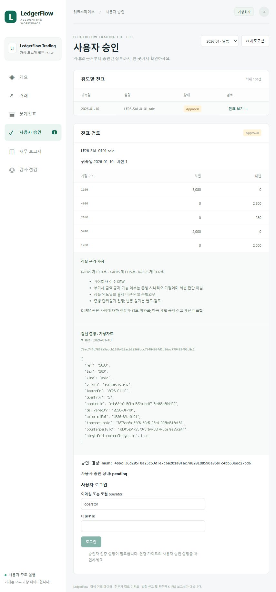

# Implementation and verification status

## 2026-10-17 원격 장부 확장

동일한 MCP 팩토리의 Cloudflare 진입점·OAuth/PKCE·DB 웹 세션·계정별 회사/ERP 1,000건·서비스 작성자/인간 승인자 분리·로그인/동의/접근 취소 UI를 구현했다. 원본 001~006 migration과 fixture/금액 엔진을 보존한다. 도구 41개와 역할 프롬프트 6개를 제공하며 native agent 자동 설치·실제 6개 역할 실행을 주장하지 않는다.

실제 PostgreSQL의 두 테스트 계정으로 거래 1,000건씩 격리, code 단일 사용/PKCE/resource/callback, 다른 회사 차단, AI 승인 scope 차단, 웹 승인 후 Posted/시산표, refresh 회전/취소를 검사했다. 테스트 소유 DB/mock Auth의 결과이며 실제 Supabase 사용자·네이티브 앱 검증은 아니다.

Supabase Auth health는 정상이나 DB는 DATABASE_AUTHENTICATION_FAILED다. 이 상태에서 원격 secrets 업로드·장부 운영 활성화를 진행하지 않는다. [사용·배포·보안 명세](REMOTE_USAGE.md)

최종 pnpm check는 **248개/36개 파일 통과**, 웹/Worker build도 통과했다. 공개 빌드 포함 키 노출은 0건이었다. 원격 배포 명령은 DB 인증 실패 단계에서 안전하게 중단됐다. 공개 안내 화면은 원격 비활성 상태로 Worker 6ef9f22a-5c3f-46aa-b89a-908093e866b9에 갱신하고 브라우저에서 새 원격 사용 순서·계정별 격리 설명·준비 중 표시를 확인했다. 실제 Workerd→Supabase DB/TLS·실제 회원가입/SMTP·네이티브 앱 OAuth·실사용자 웹 승인/전기는 아직 검증하지 않았다.

2026-10-16 KST. 사용자가 요청한 기존 프로젝트 유지·미구현 회계 기능 추가 작업의 결과다. 실제 장부 운영을 수행한 보고가 아니라 소스 개발과 합성 fixture 테스트 결과다.

## 구현 완료

- Cloudflare 공개 사이트: 기존 Worker의 정적 자산 + 읽기 전용 합성 자료 route. 기존 공통 서비스를 별도 임시 fixture DB에서 호출해 1,000건·12개월 조회 모델·공공자료 예시를 준비. 실제 사용자 장부·인증정보·키는 공개하지 않으며 공개 세션·승인·변경은 차단. [공개/로컬 기능 구분](PUBLIC_SITE.md)

- 공공자료 회계 연동: 조회/분개 공통 서비스의 DART·거래일 법령·ECOS 참고 수집, 실사업자번호 없는 국세청 제외 사유, 실제/샘플/실패 구분. 신규 전표 payload/hash에 snapshot 포함, 기존 금액·fixture/hash 보존.
- Cloudflare용 공공 API HTTP 중계와 로컬 gateway client, bearer·입력·본문·지역 쿼터·캐시, 비출력 secrets 등록/수신자 연결 명령. MCP·DB·승인 서버 추가 없음. 실제 배포 결과는 아래 검증 기록과 구분.
- 웹 공공자료 메뉴·거래 선택 조회·전표 근거 표시·현재 연결 모드, 처음 사용 안내의 공유 API 설정과 활용 범위.

- 단일 MCP 제품 `ledgerflow-accounting-mcp`, foreground HTTP/stdio, 두 앱 공유 DB·연결 설정.
- 읽기 전용 `mcp:doctor`: 프로젝트/현재 Codex 등록, 41개 도구·회사 범위 읽기, 비밀값 없는 진단 파일.
- 기존 PostgreSQL 기동 schema gate와 실패 시 연결 정리, 서버 재기동 후 Draft/hash 보존.
- ERP 1,000건과 보조자료, 원본 001~003 migration, 기존 테스트·공통 ERP 서비스·Decimal·공공 probe 보존.
- 10종 원천 거래의 결정론 Draft, 차대변·계정·증빙 hash·기간·중복 검증.
- 웹의 명시적 승인/반려, 별도 DB 승인자·CSRF·version/hash, 권한 철회 재검사, 원자적 Posted, 불변 전표.
- 원장·시산표·누적 BS·기간 IS, 승인받는 역분개, 반려/미게시 폐기 이력.
- 자산·선급 월말 차액 Draft, 모든 거래/결산 전기 후 기간 마감.
- 은행·ERP 배분·게시 현금 대사, 금액/방향/날짜/원천 일치 조건의 멱등 match.
- 무료 공공 API 4종 Adapter와 11개 도구, timeout/retry/rate/cache/provenance, live 장애의 mock 성공 전환 금지.
- 두 앱 각각 native agent/skill 6역할, Zod terminal Result 영속 기록과 허위 Posted 주장 거절.
- Astro React 대시보드, 실제 전표·근거·귀속일·버전·hash·증빙 원문 검토.
- 웹 표시명은 가상 한국회사 `한빛유통 주식회사`. 기존 fixture 이름·ID·해시와 MCP/스킬 식별자는 보존하고, 기본 1,000건이 연습용 원천 거래임을 화면에 표시.
- 장부 기록이 없을 때는 재무 금액·빈 시산표 합계를 표시하지 않고 대기 상태 제공. 누적 재무상태표와 해당 기간의 기록 유무, 실제 잔액 0원, 로딩·조회 실패를 구분.
- Supabase Auth/Storage 연결 코드, private evidence bucket/회사 RLS, 인간 JWT·canonical JSON/hash 보관과 멱등 재시도.
- 공개용 아키텍처/계획/연결/역할/도구 명세, 41개 도구의 전체 schema와 합성 요청/응답 예시, 실제 GitHub CI/Linux 이미지 검증.
- 사용자/Codex 담당표와 `deploy:check`, 비관리자 Docker/단일 Compose/health/foreground smoke 코드, Windows/Linux CI와 이미지 내부 smoke 단계.
- Aside AI용 단계별 명령 5개, 소스/DB 병행 수정 방지와 인간 승인 경계.
- 외부 JWT profile의 선택적 PostgreSQL 세션: 006 private/RLS·AES-GCM·토큰 해시·회사 AAD·재기동 복원·JWT 재검증.
- ignored `.env.local`의 비출력 `session:key`, 유효한 기존 키/설정 보존, 서버 키/MCP bearer/DB URL 노출 검사 확대.

## 검증 결과

| 검사 | 결과 |
| --- | --- |
| 공개 사이트 추가 후 `pnpm check` | Windows 242 tests / 35 files 통과, 265.32초. 신규 5개는 공개 변경/세션 차단, 전 회사·기간/커서 격리, 1,000건 페이지 조회, 원장/예시 구분을 검사 |
| 공개 자료 준비·build | 기존 공통 서비스에서 별도 임시 DB의 1,000건·12개월을 내보냄. 예시 DART/법령/ECOS public_api_live, NTS 제외. 사용자 장부 접근·전표/승인/전기 0. 웹 build·실제 Wrangler Assets dry build와 배포 파일 키 노출 0 확인 |
| 공개 사이트 실배포·화면 | Worker 버전 `283e2bad-8e27-41e5-9499-43e2b516dabe`. HTTPS HTML/context 200, 12개월·중복 없는 1,000건 조회. 공개 decision/session 403, MCP 404, 무인증 API 중계 401. 인앱 브라우저에서 한빛유통 화면·공개 미리보기 안내·거래 행 실제 표시 확인. 원격 장부 운영 증거와 구분 |
| 공공자료 연동 최종 `pnpm check` | Windows 237 tests / 34 files 통과, 228.54초. 기존 217개 + 신규 20개. 웹 build·키 노출 0건·현재 MCP 카탈로그 41개도 확인. 새 원격 CI 결과는 별도 |
| 10월 16일 정식 Adapter 실조회 | 사용자 키로 NTS 상태·DART 2025 CFS 229행·법인세법 검색/본문·ECOS USD/금리, 6회 요청·실패/재시도 0. NTS 실제 거래처 검증 아님 |
| 회계 근거 실조회 | 2026-01-10 합성 증빙 → DART 2024·2026-01-02 시행 VAT 조문·1월 금리 available/live, 4회 요청·실패/재시도 0. NTS 제외. 사용자 장부 변경 0 |
| Worker bundle | 고정 Wrangler 4.151.0의 deploy --dry-run 성공, 약 880 KiB / gzip 149 KiB, rate-limit binding 검증 |
| 공공근거/중계 신규 검사 | 단위 17개 및 별도 폐기형 PostgreSQL 3개. 금액 불변·hash 결합·승인 필요·동시 멱등·키 비노출·인증/입력/쿼터/캐시·Workers fetch/redirect 회귀 |
| 실제 Cloudflare 배포 | `ledgerflow-public-reference-gateway.eric5833.workers.dev`, 버전 `a4c02b77-0323-424e-bc8b-03265e5ef6b9`. 공공자료 HTTP 전용, MCP endpoint 없음. 키 4개+접속 토큰은 Worker secrets |
| 실제 중계 조회 | 23:15 KST 주요 도구 6/6 성공, gateway client 실패 0·캐시 재사용 3. NTS 테스트 번호·DART 2025 CFS 229행·법인세법 검색/조문·ECOS USD/금리. 모든 결과 public_api_live |
| 실제 중계 회계 근거 | 2026-01-10 증빙의 DART 2024·VAT 시행일 2026-01-02·월 금리 성공, NTS 합성 거래처 제외, 장부 변경·유료 모델 0 |
| 새 foreground MCP | localhost 정상 기동, SDK status/context·회사 범위 읽기·41개 도구 확인, mode=gateway와 실제 ECOS MCP 응답 확인. native 앱 추론 증거 아님 |
| 공개 기준 소스의 `pnpm check` | `7b3b4ba`의 실제 CI Windows/Linux 각각 192 tests / 26 files 통과, 테스트 본문 393.75초 / 62.33초 |
| Supabase 진단 개발 브랜치의 로컬 `pnpm check` | Windows 205 tests / 28 files 통과, 243.66초. 신규 12개 단위/1개 metadata 통합 포함; 새 원격 CI 결과는 아님 |
| 로컬 실행판 기동 추가 당시 `pnpm check` | Windows 211 tests / 30 files 통과, 359.19초. 단일 명령 launcher 추가 후 전체 재검사 |
| 재무 화면 개선 후 전체 `pnpm check` | Windows 217 tests / 31 files 통과, 278.38초. 신규 화면 회귀 6개 포함, 기존 회계 통합 검사 유지 |
| 로컬 실행판 기준 소스의 실제 GitHub CI | `1b944ef`, [실행](https://github.com/osh3772-star/ledgerflow-ai/actions/runs/38849513756) 전체 성공. Windows/Linux 각각 211 tests / 30 files, 평가·웹 build, Linux 이미지 build/smoke 통과 |
| `pnpm web:build` | Astro static build 통과 |
| 재무 화면 회귀 | 신규 6개 통과: 빈 원장과 실제 잔액 0원 구분, 누적/기간 분리, 최대 100건의 전표 목록과 독립된 표시, 로딩·실패 시 이전 금액 숨김 |
| `pnpm evaluate` | Draft 성공 1,000/1,000, 계정 set 분류 1,000/1,000 |
| 수기 분개 gold | 10/10 line exact match, 기존 매출 gold 유지 |
| 합성 오류 holdout | 오류 5개 모두 탐지, 정상 10개 false positive 0 |
| HTTP SDK 공유 | 클라이언트 2개, 도구 41개, 같은 회사/DB, 거래 조회 성공 |
| stdio SDK | 같은 foreground 프로세스의 stdio Draft를 HTTP에서 조회 성공 |
| 승인/전기 통합 | 로그인 없는 local browser test session + CSRF 결정 전에는 post 거절, 결정 후 DB Posted/TB 확인 |
| 결산 통합 | 완결된 2월의 원천/수정 전표를 테스트 인간 신원으로 승인·전기 후 마감, 이후 쓰기 거절 |
| 회계 방어 | 중복·외국 회사·마감·승인 hash 오류·권한 철회·라인 변조·Posted 변조 차단 |
| native 설정 | 두 앱 동일 endpoint·현재 allowlist, role/skill 동기화 |
| `pnpm mcp:doctor` | 실행 서버 41개 도구·회사 범위 1건 조회, 두 프로젝트 설정 일치, Codex CLI의 enabled HTTP 등록 일치 |
| 기존 PostgreSQL runtime | 3개 통합 검사: Draft/hash 재기동 보존, 미완성 schema 무변경 거절, 익명 승인/회사 위조 거절과 실패 시 pool 정리 |
| `pnpm deploy:check` | 당시 로컬 준비 통과, GitHub CLI 인증·commit/origin·웹 build·앱 설정 일치 확인. 로컬 Docker 미설치; 현재 hosted 연결 상태는 아래 별도 기록 |
| `pnpm container:smoke` | Windows 호스트의 테스트 소유 DB/mock에서 health·41개 도구·회사 내 1건 읽기 후 정상 종료; 실제 Docker 검증 아님 |
| 실제 GitHub CI | [실행 #3](https://github.com/osh3772-star/ledgerflow-ai/actions/runs/38819739533): Windows/Linux check·평가·웹 build, Linux Docker build/이미지 내부 smoke 모두 성공 |
| CI/Compose 파일 | YAML·PowerShell 파싱 확인, Windows/Linux matrix·contents:read·단일 host-network 서비스; Compose 실행은 별도 미검증 |
| PostgreSQL 세션 집중 검사 | 5개 통합 테스트: runtime 재연결·같은 Cookie/CSRF, 암호문 비노출, 회사/해시 복사·변조·만료·직접 접근·잘못된 RLS 거절; Auth는 stub |
| 세션 단위 검사 | TTL/삭제/암호화·키·JWT 철회·저장소 장애·CSRF·HTTPS Cookie·키 파일 보존/lock 검증 |
| skill validator | 12/12 유효 |
| 키 노출 검사 | 공개 대상 182개 파일에서 실제 API/서버 키·DB URI·Supabase publishable key raw/encoded 노출 0 |
| 수정 전 백업 | 99개 source/doc, SHA mismatch 0, 키 미포함 |
| 원본 보존 재검사 | migration 001~003과 ERP 생성 코드 2개가 기존 백업의 SHA와 일치 |

최근 로컬 evaluation은 202ms였으며 메모리 내 합성 Draft 생성/분류만 측정한다. DB round trip·앱 AI 추론·인간 승인 대기 시간을 포함하지 않는다. 이전 측정 약 59~191ms와 같은 환경에서도 변동하므로 운영 처리량 보장으로 사용하지 않는다. [측정 JSON](EVALUATION.json)

MCP 도구 호출의 duration/outcome/errorCode는 `mcp_tool_calls`와 ignored JSONL에 기록한다. 고의적인 validation/권한 거절과 정상 처리 실패를 분리해 성공률을 계산해야 한다. 프로젝트가 호출한 유료 모델 API는 0회/0원이며 구독 앱의 추론량·비용은 미측정(null)이다.

수기 gold는 10개뿐이다. 나머지 990개는 독립 line-level 정답이 아닌 계정 분류 검증이다. 작은 합성 정상/오류 표본의 Precision/Recall=1을 실제 기업 회계 정확도나 AI 판단 정확도라고 주장하지 않는다.

Storage policy는 회사 A writer 생성/A reader 조회 성공, 회사 B의 유효 preparer 조회 0, read-only writer·외국 회사 prefix·잘못된 UUID 경로 거절을 확인했다. PostgreSQL stand-in 테이블 검사이며 hosted Storage의 인증/업로드 서비스 검증은 아니다.

## Supabase 연결 준비 단위

2026-10-16 사용자 지시에 따라 기존 `회계자동화` 연결부터 진행한다. [Aside 첫 명령](ASIDE_TASKS.md#2-기존-supabase-프로젝트-설정)은 세 연결값만 직접 입력하도록 제한한다. [설정·검증 범위](SUPABASE_SETUP.md).

- `pnpm supabase:check`: Auth의 공식 health endpoint와 한 개의 read-only DB 연결로 구조 metadata를 검사한다. 키/DB URI/응답 원문을 출력하지 않으며 missing schema의 migration/seed도 하지 않는다.
- 진단과 기존 postgres runtime의 Supabase TLS 설정을 공통화했다. CA·hostname 검증, 선택 CA 파일, URL SSL 옵션의 검증 우회 거절을 적용했다.
- 집중 단위 테스트 12개와 신규 읽기 metadata 통합 검사를 포함한 로컬 `pnpm check` 205개/28 files 통과(243.66초). 기존 회계 assertion과 제한 시간은 유지했다.
- 첫 전체 실행은 204개 통과/기존 upgrade 테스트 1개 60초 초과였다. Windows `pg_ctl`의 상속된 stdout pipe가 명령 종료를 지연시키는 것을 분리 측정했다(기존 35.027초, `spawn`/`stdio: ignore` 0.892초). readiness `-w`와 시작/종료 제한은 유지하고 pipe를 분리했다. 해당 upgrade 테스트는 수정 후 19.16초에 통과했고, 이어 위 전체 검사를 통과했다. Linux 기동 경로와 소유한 임시 DB만 정리하는 경계는 유지했다.
- 실제 세 연결값과 공개 CA를 등록했다. 재검사에서 Auth health HTTP 200/GoTrue를 확인했으며 DB는 인증서 오류 대신 `DATABASE_AUTHENTICATION_FAILED`로 미연결이다. 설정 중복/상속/활성값·파일 일치/사용자명/포트/드라이버 decode의 비출력 검사는 정상이다. 사용자가 시연판 마무리를 우선해 추가 재입력 요청을 보류했다. 실제 Auth 사용자, Storage, 데이터 초기화, profile 전환은 아직 미검증/미수행이다.
- 이 단위의 개발 브랜치는 `codex/supabase-connection-check`다. 기존 공개 기준 CI 기록의 192개 결과를 새 진단 소스의 원격 CI 결과로 바꾸지 않는다.

## Supabase 최초 schema 설치 단위

`supabase:init --offline`은 네트워크 없이 원본 6개 migration의 순서/bytes/SHA256과 transaction framing을 검증하고 ignored manifest를 만든다. 기본 `supabase:init`은 실제 연결 후 읽기 전용으로 기존 객체와 Auth/Storage 제공 여부를 확인한다. `--apply --project=... --hash=...`만 명시적 최초 설치를 허용한다. 한 트랜잭션·제한된 advisory lock·private/RLS receipt를 사용하며 기존 객체/다른 hash/로컬 Auth emulator를 거절한다. 이미 완료한 같은 설치는 쓰지 않고 반환한다. 기존 schema upgrade나 CLI history repair 도구는 아니다.

- 집중 테스트 14개 통과(새 최초 설치 5개 + 진단 9개). 후기 DDL 장애에서 앞선 테이블/receipt까지 rollback, unrelated 데이터 보존, 재실행 멱등성, Auth 사용자/ERP/전표 0행을 테스트 소유 native DB에서 확인했다.
- 최초 설치 소스의 전체 `pnpm check` 211개/30 files 통과(301.64초). 후속 단일 명령 로컬 launcher를 추가했으며 최종 전체 검사는 별도 기록한다. 기존 205개 로컬/192개 CI 기록과 구분한다.
- 실제 hosted 적용은 DB 인증정보 거절로 수행하지 않았다. 인증서가 있는 것만으로 DB 연결 성공이나 초기화를 완료 처리하지 않는다.
- 새 hosted fixture 적재·실제 Auth UUID 매핑은 아직 미구현이다. 기존 native seed의 bootstrap 전용 제한을 보존했고 Auth 사용자 직접 INSERT로 우회하지 않는다. 실제 Auth/Storage/RLS·서버 전환·두 앱의 사용자 승인 후 Posted 수용 검증도 남아 있다.

## 로컬 포트폴리오 실행판

사용자가 추가 클라우드 설정보다 실행판 마무리를 우선했다. `pnpm start`를 추가해 웹 build → 기존 단일 foreground demo 서버를 한 번에 실행한다. 해당 프로세스에만 `demo`/빈 DB URL/`memory` session을 명시적으로 선택한다. 파일의 Supabase/API 키·CA를 변경하지 않고 지속 profile의 URL 충돌 거절·외부 JWT 통제도 그대로 유지한다.

실제 `pnpm start` 기동과 Astro build를 통과했다. 기존 소유 서버를 `stop`으로 종료한 뒤 새 서버 하나를 `127.0.0.1:8787`에 기동했다. 이어 `mcp:doctor`에서 41개 도구·회사 범위·합성 거래 1건 읽기·두 프로젝트 설정/Codex CLI 등록 일치를 확인했다. 장부 변경·공공 API 호출·유료 추론은 0회다. 실제 앱 추론은 여전히 별도 미검증이며 이번에 새로운 브라우저 시각 검토를 수행한 것은 아니다.

단일 명령 추가 후 최종 전체 `pnpm check` 211개/30 files가 통과했다(359.19초). `pnpm evaluate` 1,000건·수기 gold 10개·오류 5개, 웹 build, 실행 중인 MCP의 읽기 진단도 통과했다. 공개 대상 182개 파일의 실제 키 노출은 0건이다. [실행/시연 순서와 제한](PORTFOLIO_READY.md). 현재 사용자가 수행할 새 Aside 작업은 없다.

## 실제 공공 API 확인 범위

2026-10-14 실키 진단과 이후 Adapter 읽기 요청으로 확인했다. 최초 4회 진단 기록은 [API_CONNECTIONS.md](API_CONNECTIONS.md)에 보존한다.

| API / 실제 확인 | 증거 | 남은 범위 |
| --- | --- | --- |
| 국세청 상태조회 | HTTP 200/status_code OK, 미등록 테스트 번호 정상 응답 | 실제 거래처 정상 영업·진위 매칭 미검증 |
| DART 공시검색 | status 000, 공시 응답 | 실제 감사보고서 문서 다운로드 미구현 |
| DART 전체 재무제표 | 2025/CFS/연간, status 000, 계정 229행 | 기업 비교는 mock/파생 로직, 실제 업종 자동 매칭 없음 |
| 법령 검색·제1조 | 법인세법 시행 버전과 6자리 JO 응답, 시행일 2026-07-01 | 모든 과거 개정/부칙 적용 판단은 인간 검토 |
| ECOS GDP | 검증한 registry와 실제 연도 관측 | 임의 통계 자동 발견 없음 |
| ECOS USD 환율 | 2026-10-14 관측, 단위 원, 요청/관측일 기록 | JPY 100엔은 metadata/단위 registry 검증; 모든 통화 live 아님 |
| ECOS 기준금리 | 2026년 1~9월 9개 관측 | 시장금리/별도 일별 시리즈 없음 |

전체 11개 공공 도구는 네트워크 없는 mock에서 테스트한다. 공공 자료는 `public_api_live`/`mock` 출처이고 가상 장부로 적재하지 않는다. 조회 결과만으로 법령 적용·세금·K-IFRS 결론이 확정되지 않는다.

## 미검증 / 미구현 구분

| 항목 | 상태 / 필요한 다음 작업 |
| --- | --- |
| 실제 Claude Code와 Codex의 연결·역할 추론 | 설정/SDK/자가진단 완료, Codex CLI 등록 일치; Claude Code 실행 파일 미발견, 실제 앱 추론 수용 테스트 미수행 |
| 실제 Supabase Auth/Storage/PostgREST | Auth health HTTP 200 확인; 사용자 JWT·Storage·PostgREST 동작은 미검증 |
| Storage RLS SQL | PostgreSQL stand-in 테이블에서 policy 검증, 실제 Storage 서비스/JWT 검증과 구분 |
| 외부 지속 PostgreSQL runtime | 테스트 소유 native DB 재연결·보존 검증; 실제 Supabase는 CA 등록 후 DB 인증정보 거절로 미연결 |
| hosted fixture 초기 적재 | native 1,000건 seed는 보존; 실제 Auth UUID 매핑과 hosted 전용 적재 절차는 미구현 |
| 원격 MCP OAuth·HTTPS·외부 세션 저장소 | 암호화 PostgreSQL 세션은 구현/로컬 검증; 실제 provider·MCP OAuth/HTTPS는 미구현/미검증, loopback 유지 |
| 로컬 Docker Desktop/Compose | Linux 이미지의 실제 CI build/run 통과. 로컬 설치는 생략했으며 Desktop·host-network Compose는 미검증 |
| Cloudflare 장부 backend | 미배포; native DB/fs/Node HTTP/session 때문에 Workers 전체 호환 미입증. 별도 공공자료 전용 HTTP 중계는 실제 배포/실조회 검증 완료 |
| 전문 회계/세무 범위 | 세금 산출·현금흐름표·주석·전문가 K-IFRS 검토·실제 은행/정부 세금계산서 연동 미구현 |

무료 개발 경로는 로컬 Node+DB+기존 앱 구독이다. Supabase Free/Pro와 배포 제약은 [ARCHITECTURE.md](ARCHITECTURE.md)에 공식 출처와 함께 정리했다.

## 재현 및 다음 최소 단위

```powershell
pnpm check
pnpm evaluate
pnpm web:build
pnpm deploy:check
pnpm container:smoke
pnpm mcp:start
# 다른 터미널
pnpm mcp:smoke
pnpm mcp:doctor
pnpm mcp:catalog
```

`pnpm mcp:examples`는 **폐기 가능한 demo + mock에서만** 문서용 Draft/승인 요청과 오류 예시를 생성한다. 인간 승인/Posted는 수행하지 않는다. 출력은 `MCP_EXAMPLES.json`이며 영구 DB/live 환경에서는 실행을 거절한다.

다음 최소 단위는 실제 두 앱에서 공유 매출 Draft 하나를 조회·검증·승인 요청하고, 사람이 화면에서 결정한 뒤 앱이 DB Posted와 시산표를 확인하는 수용 테스트다. 로컬 demo는 로그인 없이 바로 승인·반려 버튼을 사용할 수 있다. 같은 출처 브라우저 세션을 자동 준비하지만 자동 승인·전기는 하지 않는다. 이 개발 모드는 인간 신원 인증이 아니며 지속 DB에는 외부 인증이 필요하다. Supabase 실검증에는 개발 프로젝트 연결값과 실제 Auth 사용자 provision이 필요하다.

2026-10-15 변경: 로그인 폼·로그인 API·데모 비밀번호 설정을 제거했다. 로컬 브라우저 세션만으로 사용자의 명시적 승인/반려가 가능하고, 지속 DB는 외부 JWT 검증을 유지한다. 누락 CSRF·다른 출처 세션 요청·익명 지속 DB 요청 거절과 실제 PostgreSQL 전기 흐름을 테스트했다. 이번 브라우저 화면 검증은 자동 승인 검사의 localhost URL 접근 거절로 수행하지 못했으며 웹 build는 통과했다.

후속 변경: `mcp:doctor`의 실행 서버 진단을 통과했으며 `.ledgerflow/readiness/latest.json`에 비밀값 없는 결과를 저장했다. 기존 PostgreSQL profile은 독립 native DB에서 재기동 보존과 초기화 실패 시 pool 정리를 검증했다. 이 단계에서 공공 API/유료 모델 API 호출과 실제 사용자 장부의 승인·전기는 수행하지 않았다. 검증용 foreground 서버는 정상 종료했다.

담당 분리 후 [사용자 작업과 Codex 작업](WORK_ASSIGNMENTS.md), [배포 실행 문서](DEPLOYMENT.md)를 추가했다. 배포 준비 명령과 smoke는 장부 승인/전기를 하지 않는다. Docker/CI 관련 수정 전 공개 source/doc 9개를 실제 키 없이 별도 백업했다.

Aside용 [독립 명령 5개](ASIDE_TASKS.md)와 [선택적 세션 저장 설계](SECURITY_SESSIONS.md)를 추가했다. 세션 관련 기존 source/doc 11개를 실제 키 없이 백업한 뒤 006만 새로 추가했다. 이 구현은 로그인 UI/API·자동 승인·전기·새 MCP 서버·스케줄러를 추가하지 않았으며 실제 사용자 환경의 DB/키 설정도 변경하지 않았다.

GitHub 초기 공개 점검에서 native 역할 frontmatter의 LF와 기존 migration/generator의 원본 bytes를 Git 속성으로 고정했다. CI는 main push와 PR만 대상으로 같은 변경의 중복 branch-push 실행을 줄였다. Windows의 임시 DB 정리 `EBUSY`를 재현해 소유한 임시 경로의 삭제에만 제한된 재시도를 적용했다. 계정 저장소 push 권한과 연결 앱의 실제 쓰기 권한은 구분하며, 403 이후 다른 API로 우회하지 않았다.

2026-10-16 초기 준비: 공개 대상 169개 파일의 로컬 초기 커밋 `7a0bc6d`와 origin을 준비했다. 서버를 다시 기동한 뒤 `mcp:doctor`에서 41개 도구와 회사 범위 1건 읽기를 확인했다. Aside 안내에는 기존 `회계자동화` 재사용과 로컬 Docker 설치 생략 결정을 반영했다.

2026-10-16 공개 검증 완료: 사용자의 CLI 인증 후 코드를 업로드했다. 초기 Windows CI의 임시 폴더 권한과 직접 `postgres.exe` 기동 문제를 수정한 소스 `7b3b4ba`에서 Windows/Linux 각각 192개 테스트와 Docker 비관리자 이미지 내부 41개 도구·회사 내 1건 읽기가 통과했다. [실패·수정·실행 증거](CI_VALIDATION.md). 실제 앱 호출과 hosted Supabase는 여전히 미확인이며 사용자 장부 승인·전기는 수행하지 않았다. 기존 migration과 ERP 생성 코드는 초기 공개 커밋과 동일하다.

아래 이미지는 로그인 제거 전의 검증 기록이다.


