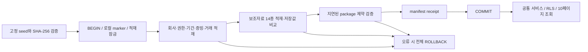

# P2-B2 — ERP 관계형 적재·RLS·내부통제 검증

2026-10-14 완료. 주회사 거래 **1,000건**과 격리 회사 **1건**,
가상 ERP 보조자료 전체를 **실제 로컬 PostgreSQL 17.10**에 원자적으로 적재했다.
이 결과는 Supabase 전체 스택 검증과 구분한다.

## 실행

```powershell
pnpm install --frozen-lockfile
pnpm demo:full
pnpm check
```

`demo:full`은 임시 PostgreSQL을 생성하고 migration 전체를 파일명 순서로 적용한다.
같은 fixture를 두 번 적재한 뒤, 기존 `ErpService.getTransactions`로
100건씩 10페이지를 조회하여 주회사 1,000건이 모두 반환되는 것을 확인한다.
계정 비밀번호는 출력하지 않으며 종료 시 소유한 workspace 임시 DB만 정리한다.
외부 API·모델 API 요청은 **0회**다. 발급 키를 읽거나 변경하지 않는다.

## 적재 결과

| 테이블 | 전체 건수 |
| --- | ---: |
| business_transactions / source_documents | 각 1,001 |
| counterparties / products / bank_accounts | 41 / 21 / 3 |
| sales_contracts | 260 |
| invoices / invoice_lines | 각 493 |
| inventory_movements / bank_transactions | 481 / 414 |
| settlement_allocations | 340 |
| fixed_assets / prepayments | 12 / 24 |
| payrolls / accruals | 36 / 48 |
| adjustment_proposals | 59 |
| audit_logs | 4,727 |

seed `20261014`, 버전 `lf-erp-1000-v1`, 원본 SHA-256은 P2-B1과 같다:
`7b39cbe1ca5695767702c02b61b4222799f2df8a08a38a22151cd1bd1e9f0820`.
최초 CLI 실행에서 첫 적재 **1,872ms**, 동일 fixture 재적재 **1,062ms**를 측정했다.
이는 이 Windows 머신·고정 데이터 한 번의 실행 측정이며 운영 처리량 보장은 아니다.
재적재에서 `reused=true`를 받았고 거래·보조자료·감사 로그가 중복되지 않았다.

## 관계와 원자적 적재



모든 회사 소유 엔터티에 `UNIQUE(company_id,id)`와 같은 회사의 부모만 참조하는
복합 FK `(company_id,parent_id)`를 적용했다.
거래처·상품·은행·거래·증빙·인보이스·자산·선급비용의 교차회사 참조를 차단한다.
주요 날짜·부모·배분 조회에 회사가 선두인 인덱스를 추가했다.

금액과 수량에는 typemod 없는 numeric domain을 사용하여 원 단위 미만 입력이
CHECK 실행 전에 반올림되어 통과하는 것을 방지한다.
`erp_won`은 0 이상, 10^18 미만의 정수 원이다.
`erp_quantity`는 0 초과, 10^12 미만의 정수 수량이다.
세금계산서의 `gross=net+tax`, 명세행의 `net=quantity×unit_price`,
급여의 `gross=withholding+net_pay`를 SQL에서 검증한다.

인보이스→명세행, 은행→급여처럼 한 패키지 안에서 뒤에 적재되는 행은
DEFERRABLE constraint trigger로 전체 자료를 본 뒤 검증한다.
loader는 manifest receipt 이전에 `SET CONSTRAINTS ALL IMMEDIATE`를 실행한다.
증빙 원문·메타데이터, 거래 실제 컬럼, 보조자료 실제 컬럼을 fixture와 비교한다.
기존 hash 또는 receipt만 믿고 정상으로 판정하지 않는다.

## 권한과 감사

새 보조자료 14종과 audit_logs에 RLS를 ENABLE/FORCE했다.
`erp:read`는 활성 membership·principal·scope와 만료일을 검사한다.
애플리케이션에서 회사 WHERE가 빠져도 다른 회사의 행이 보이지 않는다.

`erp:write`인 preparer는 자기 회사의 일반 ERP 자료를 INSERT할 수 있다.
viewer·anon 쓰기, 모든 일반 클라이언트의 UPDATE/DELETE를 허용하지 않는다.
수금/지급 배분·수정 제안은 이번 단계의 신뢰된 로컬 적재기만 작성하고,
일반 authenticated 클라이언트의 직접 INSERT를 허용하지 않는다.
후속 대사 확정 서비스에는 별도 승인·권한 경로를 추가해야 한다.

INSERT 감사 로그에는 회사·entity/table·ID·trace ID·인증된 사용자 참조·시각만 남긴다.
증빙 원문, 금융식별자, 키를 복제하지 않는다.
로컬 관리자 적재는 actor_user_id가 null이고 단일 적재 trace로 묶인다.
audit_logs 직접 INSERT 권한이 없으며 UPDATE/DELETE는 DB trigger로 차단한다.
실패한 트랜잭션의 감사 INSERT도 함께 롤백된다.
**거절 이벤트를 별도 트랜잭션으로 보관하는 운영 감사 서비스는 후속 구현이다.**

## 수금/지급 한도와 동시성

`settlement_allocations`는 ERP 원천의 은행·인보이스 연결이다.
전표/원장 행과 연결되는 설계상의 `reconciliation_matches`와 구분하고,
회계 대사 확정이나 승인·전기를 수행한 것으로 취급하지 않는다.

배분 INSERT는 은행 행→인보이스 행의 고정 순서로 잠근다.
거래 참조·입출금 방향·인보이스 방향·일자와 기존 합계에 대한 한도를 확인한다.
은행/인보이스의 `allocation_version`만 증가시켜 오래된 snapshot의 쓰기를 감지한다.
금액 잔액을 캐시하는 필드로 사용하지 않으며 잔액은 원천 행의 합계로 산출한다.

두 세션이 잔여 150원인 인보이스에 각각 100원을 배분하는 경쟁을 실제 DB에서 만들었다.
두 번째 세션이 Lock 대기 상태인 것을 확인한 뒤 첫 세션을 COMMIT했다.

| 격리 수준 | 첫 배분 | 두 번째 배분 | 보존된 잔여 금액 |
| --- | --- | --- | ---: |
| READ COMMITTED | 성공 | `23514` 초과 배분 거절 | 50원 |
| REPEATABLE READ | 성공 | `40001` serialization failure | 50원 |

운영 쓰기 서비스는 `40001`·`40P01`을 받으면 전체 트랜잭션 단위의 제한된 재시도를 구현해야 한다.
이 로컬 fixture 적재기는 한 전역 advisory lock을 사용한다.
해당 격리/잠금 동작은 [PostgreSQL 17 공식 격리 수준 문서](https://www.postgresql.org/docs/17/transaction-iso.html)와
[트리거 문서](https://www.postgresql.org/docs/17/trigger-definition.html)를 확인하고 실제 경쟁 테스트로 검증했다.

## 테스트 결과

`pnpm check`: TypeScript 검사 + **90개 테스트 / 7개 파일 통과**, 44.02초.
기존 71개에 이번 19개의 실제 PostgreSQL 통합 테스트를 추가했다.

추가 검증:

- 14종 보조자료 전부의 적재 수, RLS ENABLE/FORCE, 1,000건 공통 서비스 pagination.
- 동시 재적재 직렬화, 거래/감사 로그 중복 방지, 원본 hash/초기 상태/manifest 건수 위조 차단.
- 모든 새 테이블·감사 이력의 A/B 격리, anon·viewer·교차회사 INSERT·클라이언트 수정 거절.
- FK, 금액·수량·수익 증빙·급여 증빙·차감 배분·기간 마감 오류 차단.
- 저장된 명세행 변경, hash가 그대로인 증빙 원문 변경 탐지.
- 마지막 수정 제안의 FK 오류로 새 회사 적재 실패 시 회사·Auth 사용자·기초자료·보조자료·감사·receipt 전체 롤백.
- READ COMMITTED / REPEATABLE READ의 인보이스 초과 배분 경쟁 차단.

Git 공개 대상 소스·문서에서 설정 키의 원문/URL 인코딩 표현 노출 **0건**을 확인했다.
실제 dotenv, API 캐시, seed JSON은 Git에서 제외된 상태다.

## 적용 범위와 다음 최소 단위

`202610140002_erp_subledgers.sql`은 Supabase Auth가 존재하는 환경용 후속 migration이다.
테스트의 `auth-bootstrap.sql`과 Auth 사용자 직접 INSERT를 운영 Supabase에 적용하지 않는다.
적재기는 로컬 marker가 없으면 차단한다.
실제 Supabase JWT/PostgREST/Storage, 원격 연결, 운영 계정 권한은 아직 검증하지 않았다.

이번 스키마는 synthetic KRW·정수 상품 수량·고정 SKU 원가의 데이터 시나리오 범위다.
수정 제안 59건은 여전히 proposed이며 완전한 월말/연말 결산 결과가 아니다.
가상 거래처의 실번호, 공공기업 장부, 실제 급여세 계산은 포함하지 않는다.

다음 **P2-C**는 ERP 조회·생성 공통 서비스다.
> 이후 [P2-C 서비스 구현·검증](PHASE_2C.md)을 완료했다. 이 문서는 P2-B2 당시 측정 기록이다.
기존 getTransactions에 세금계산서·은행·재고·거래처 조회를 추가하고,
증빙과 미처리 거래의 원자적 생성에 Zod·권한·멱등성·감사 계약을 적용한다.
이를 마친 뒤 **P3-A**에서 매출 한 건의 LLM 독립 분개 계산과
차대변·계정·증빙·기간 검증으로 Draft→Validated를 구현한다.
승인·전기는 P3-B의 별도 원자적 서비스 단위에서 연결한다.
