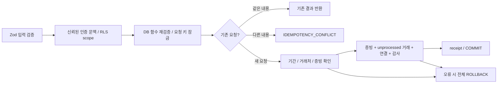

# P2-C — ERP 공통 조회·생성 서비스

2026-10-14 완료. 웹·MCP가 함께 사용할 `ErpService` 7개 메서드를 구현했다.
기존 package workspace, seed, RLS, 전기기간 제약과 DB migration을 유지했다.
MCP 도구 등록·HTTP 라우트·회계 분개/전기는 후속 단계다.

## 실행과 검증 결과

```powershell
pnpm demo:services
pnpm check
```

`demo:services` 실행 결과:

| 항목 | 실제 결과 |
| --- | --- |
| 1월 매출 세금계산서 | 20건 |
| 1월 ERP 원천 배분이 없는 은행거래 | 8건 |
| 1월 말 SKU-01 재고 | 58개, 원천 원가 추정 58,000원 |
| 거래처 이름 부분 검색 | 1건 |
| 가상 매출·증빙 생성 | 공급가 100,000원 + 세액 10,000원, `unprocessed` |
| 같은 키 재요청 | 같은 거래 ID, `reused=true` |
| 미처리 거래 조회 | 새 거래 포함 |
| 외부 API / AI 호출 | 0회 / 0회 |

TypeScript 검사 + **119개 테스트 / 10개 파일 통과**, 75.80초.
P2-B2의 90개 테스트에 이번 입력 경계 15개·서비스 DB 13개·기존 DB 업그레이드 1개를 추가했다.
회계 정확도·K-IFRS 준수 평가의 통과 결과는 아니다.

## 서비스 계약

| 메서드 | 입력 | 반환 / 동작 | 권한 |
| --- | --- | --- | --- |
| getTransactions | 회사·기간·kind/status·페이지 | 업무거래 Page | erp:read |
| getUnprocessedTransactions | 회사·기간·kind·페이지 | `unprocessed`만 조회 | erp:read |
| getInvoices | 회사·기간·direction·transactionId·페이지 | 증빙 hash·명세행 포함 세금계산서 Page | erp:read |
| getBankTransactions | 회사·기간·bankAccountId·unmatchedOnly·페이지 | 입출금·ERP 배분/미배분 금액 Page | erp:read |
| getInventory | 회사·asOf·productId·페이지 | 입출고 집계·원가 상태 Page | erp:read |
| getCounterparties | 회사·이름 부분 검색·페이지 | 가상 거래처 Page, 실번호 없음 | erp:read |
| createTransaction | 회사·거래 종류·일자·금액·증빙·멱등성 키 | Transaction + documentIds + reused | erp:write + 활성 human preparer/admin |

기간 입력은 from≤to, 날짜는 YYYY-MM-DD, 페이지 크기는 1~100, cursor는 최대 512자다.
금액은 정수 원의 정확한 십진 **문자열**이다.
조회와 생성의 입력·출력은 Zod 계약을 사용한다.
인보이스 API의 `sales`는 DB의 `sale`에 명시적으로 매핑한다.
기존 `PostgresTransactionRepository` 이름은 새 `PostgresErpRepository`의 호환 export로 유지했다.

Cursor는 회사·엔드포인트·기간·필터에 묶인다. 다른 필터로 재사용하면 거절한다.
페이지 크기를 바꿔 이어 읽을 수 있다. 날짜/ID의 안정된 정렬을 사용한다.
Cursor 자체는 인증 수단이 아니며 매 요청에서 membership·scope·RLS를 다시 확인한다.
이름 검색은 SQL parameter + literal substring이므로 `%`와 SQL 문장도 검색 문자로 취급한다.

## 생성 입력과 증빙

아래는 로컬 가상회사 대상의 예시다. 인증된 사용자 ID·상태·기간 ID·hash를 입력에 받지 않는다.

```json
{
  "companyId": "9c8ea756-7981-5f3d-a272-2640a18054be",
  "idempotencyKey": "example-sale-v1",
  "externalRef": "EXAMPLE-SALE-001",
  "kind": "sale",
  "occurredOn": "2026-12-30",
  "recognitionOn": "2026-12-30",
  "currency": "KRW",
  "net": "100000",
  "tax": "10000",
  "gross": "110000",
  "documents": [
    {
      "documentType": "synthetic_invoice",
      "issueDate": "2026-12-30",
      "content": {
        "origin": "synthetic_erp",
        "externalRef": "EXAMPLE-SALE-001",
        "description": "가상 증빙 메타데이터"
      }
    }
  ]
}
```

기존 증빙은 `documents` 대신 `documentIds: UUID[]`를 사용한다.
둘 중 하나를 반드시 선택하고 1~20개를 연결하며 중복 참조를 거절한다.
첫 증빙을 `sourceDocumentId`로 유지하고 전체를 `transaction_documents`에 순서대로 보관한다.
기존 거래의 주증빙은 migration에서 backfill하고 이후 INSERT에서도 자동 연결한다.

새 증빙 메타데이터는 16KiB 이하, 깊이 8 이하, 배열 100개·객체 필드 64개 이하다.
필드명은 ASCII identifier, 텍스트 값은 한글/Unicode를 지원한다.
JSON 숫자는 안전한 정수이며 금액·소수는 문자열로 입력한다.
이는 고정 canonical hash와 입력 크기를 검증하기 위한 현재 ERP 계약이다.
증빙 이미지/PDF 업로드와 실제 세금계산서 수집은 구현하지 않았으며 Storage 경로는 null이다.
공공 API 원문을 가상회사 증빙으로 자동 변환하지 않는다.

## 저장 흐름과 멱등성



DB 함수 `public.create_erp_transaction`은 원문 입력에서 SHA-256 fingerprint를 직접 계산한다.
클라이언트가 보낸 hash를 신뢰하지 않는다.
금액을 서비스에서 정규화하므로 `100`과 `100.000000`의 재요청은 같은 것으로 처리한다.
같은 회사/키의 동시 요청은 한 번만 저장되고 나머지는 같은 거래를 반환한다.
외부 참조 중복·잘못된 후기 증빙이 있으면 먼저 INSERT한 새 증빙과 감사도 함께 롤백한다.

증빙은 내용 hash로 중복 저장을 방지하고 문서 종류·발행일·내용까지 비교한다.
저장된 기존 증빙의 내용 hash도 검증한다.
여러 내용 hash를 정렬된 순서로 잠가 동시 증빙 생성의 잠금 순서를 일정하게 유지한다.
현재 compact canonicalizer는 제한된 ERP JSON 계약용이며 일반 RFC 8785 구현으로 주장하지 않는다.
해시 연산은 [PostgreSQL 17 공식 SHA-256 함수](https://www.postgresql.org/docs/17/functions-binarystring.html)를 확인하고 fixture hash와 실제 저장값을 비교했다.

새 거래의 기간은 recognitionOn으로 찾아 잠근다. open 기간에서만 새 거래를 생성한다.
이미 성공한 요청은 기간 마감 후에도 동일 결과를 반환하며 다시 저장하지 않는다.
재요청에서도 호출 권한을 먼저 확인하여 membership 회수 후 결과를 반환하지 않는다.
거래처 참조는 같은 회사여야 하고 매출/수금은 customer, 매입/지급/자산은 supplier로 검증한다.

## 권한·감사·오류

호출자 ID는 repository 생성 시 신뢰된 서버 인증 문맥에서 받는다.
도구·서비스 입력으로 `actorUserId`, `status`, `posted` 등을 주입하면 거절한다.
DB 함수도 이를 다시 거절하고 human preparer/admin인지 확인한다.
viewer에 erp:write scope가 잘못 붙어도 거래 생성을 허용하지 않는다.
agent principal의 생성은 금지한다. 실제 원격 인증·AI 역할별 MCP 도구 등록은 후속 검증 대상이다.

생성은 source_documents·business_transactions·transaction_documents의 INSERT 감사를 같은 trace로 남긴다.
조회도 회사·resource·사용자·trace·시각을 `erp_read`로 기록한다.
원문 증빙·검색어·금액·키를 감사 로그에 복제하지 않는다.
원시 DB SELECT 자체의 감사와 실패 요청의 별도 기록은 아직 구현하지 않았다.

외부에 반환할 오류는 원문 SQL/입력을 포함하지 않는 DomainError로 제한한다:
`INVALID_INPUT`, `INVALID_CURSOR`, `FORBIDDEN`, `REFERENCE_INVALID`, `PERIOD_CLOSED`,
`IDEMPOTENCY_CONFLICT`, `DOCUMENT_CONFLICT`, `DUPLICATE_SOURCE`, `DATA_INTEGRITY`,
`RETRYABLE_CONFLICT`, `DATABASE_ERROR`.
직렬화/교착/잠금 오류의 제한된 자동 재시도는 향후 운영 실행 계층에 추가하며,
현재는 같은 멱등성 키로 전체 요청을 재시도하도록 분류한다.

## 회계 의미와 남은 작업

`getBankTransactions.unmatchedOnly`는 현재 ERP 원천 배분의 미배분 잔액을 기준으로 한다.
`erpAllocatedAmount`는 회계전표/원장의 승인된 대사 금액이 아니다.
재고 `carryingAmount`는 고정 SKU 원가 시나리오의 원천 추정값이며 `costStatus=source_estimate`를 표시한다.
여러 단위원가·음수 재고·현재 SKU 원가 불일치가 있으면 pending/null을 반환한다.
asOf는 입출고 날짜에 적용하며 상품 카탈로그의 과거 버전을 재구성하지 않는다.
정식 이동평균/FIFO 원가와 K-IFRS 재고평가는 회계 엔진 단계에서 구현한다.

거래 생성은 `unprocessed` 업무거래만 만든다.
세금계산서·은행·재고·계약 보조자료까지 자동 생성하거나 승인·전기를 수행하지 않는다.
실제 Supabase JWT/PostgREST/Storage, Cloudflare 런타임과 HTTP/MCP 연결은 미검증이다.

업그레이드 테스트는 P2-B2 DB에 1,001건을 먼저 적재하고 1월을 마감한 다음
P2-C migration을 적용했다. 기존 거래 hash·증빙·마감 상태 보존과 주증빙 1,001건 연결을 확인했다.
기존 고정 seed·manifest는 변경하지 않았다.

다음 최소 단위는 **P3-A: LLM 독립 매출 분개 Draft 생성·검증**이다.
사전 작성한 정답 fixture와 정확한 Decimal 계산을 비교하고,
계정·차대변·증빙·기간 검증으로 Draft→Validated를 구현한다.
승인·원자적 전기는 P3-B로 이어진다.

실패 테스트의 임시 DB 폴더 `.ledgerflow/tmp/pg-Mqbb18`는 재귀 삭제가 자동 승인 검토에서
정책상 차단되어 보존했다. 해당 PostgreSQL 프로세스는 종료됐고 API 키를 적재하지 않은 가상 데이터다.
마지막 전체 테스트와 서비스 데모의 임시 DB는 정상 종료·정리했다.
