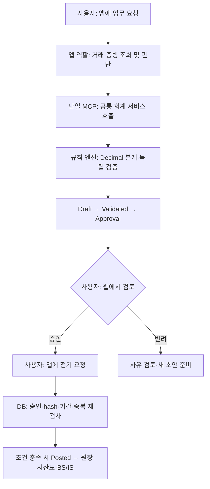

# LedgerFlow 사용 안내

2026-10-16 기준. **로그인 없는 로컬 시연판이며 공공자료의 실제 조회와 분개 근거 첨부를 지원한다.** 새 설치는 키 없이 샘플 모드로 시작한다. 현재 PC는 Cloudflare 공유 중계에 연결했고 새 MCP 서버에서 `gateway` 모드와 실제 응답을 확인했다. 기존 키와 `ADAPTER_MODE=live`는 보존했다. 사용자가 Claude Code 또는 Codex에 요청하면 분개·검증을 수행하고, 사용자가 화면에서 승인한 전표만 장부에 반영할 수 있다.

## 1. 무엇이 연결되어 있나

| 대상 | 확인된 상태 | 현재 사용 범위 |
| --- | --- | --- |
| 로컬 PostgreSQL / ERP | 정상 기동·조회 확인 | 가상회사 거래 1,000건, 별도 격리회사 1건. 종료 시 초기화되는 시연용 DB |
| 공유 MCP 서버 | SDK 연결과 41개 도구 확인 | 두 앱이 같은 `ledgerflow-accounting-mcp`를 사용 |
| 국세청 | 실조회 성공 이력 | 사업자 상태조회. 미등록 테스트 번호 응답을 확인했으며 실제 거래처 정상 영업·진위 매칭은 미검증 |
| DART | 실조회 성공 이력 | 공시검색과 2025년 연결 재무제표 229행. 가상회사 장부와 별개인 참고자료 |
| 국가법령정보 | 실조회 성공 | 법인세법 검색·제1조, 1월 거래에 적용 가능한 부가가치세법 제30조·시행일 확인 |
| ECOS | 실조회 성공 이력 | GDP·USD 환율·월 기준금리. 모든 통화/통계의 실조회를 검증한 것은 아님 |
| Supabase | Auth health 응답, DB 연결 미완료 | 키·CA 등록 완료. 최근 DB 연결은 `DATABASE_AUTHENTICATION_FAILED`; 초기 적재와 실제 Storage 검증은 보류 |
| 실제 Claude Code / Codex 앱 | 설정 준비, 앱별 사용 검증 남음 | SDK 성공과 실제 앱의 추론/도구 호출 성공을 구분 |

10월 16일 정식 Adapter 6회 실조회가 모두 성공했다. 추가로 2026-01-10 합성 증빙의 DART·법령·ECOS 자동 근거 수집도 4회 요청으로 성공했다. 국세청은 실제 번호가 없어 자동 조회에서 제외했다. [실조회 기록](API_CONNECTIONS.md), [최신 검증 범위](IMPLEMENTATION_STATUS.md).

같은 날 Cloudflare 배포 후 주요 조회 6개와 과거 거래일 근거 수집도 중계 경유로 모두 성공했다. 새 foreground MCP는 도구 41개와 공유 연결 모드를 확인했다. 다른 PC는 [공유 연결](PUBLIC_GATEWAY.md)의 접속 토큰 1회 설정이 필요하다.

**키 등록·실조회 성공·현재 서버 모드는 서로 다르다.** 설정을 바꿔도 실행 중인 서버에는 재시작 전까지 적용되지 않는다. 개요·공공자료 메뉴의 연결 모드와 개별 자료의 실제/샘플 표시를 확인한다. ERP 자료는 어느 모드에서도 합성 데이터다. Supabase 연결이 없어도 로컬 회계 시연은 가능하다.

## 2. 사용자가 실행하는 순서

**시작은 기존 ERP 자료에 대한 분개 요청이다.** 샘플 1,000건은 1년치 원천 거래이며 이미 분개·전기가 끝난 자료가 아니다. 처음에는 새 거래를 입력하지 않고 코덱스 또는 클로드 코드에 **“기존 ERP의 2026년 1월 미처리 거래를 분개해 줘”**라고 요청한다. 앱이 전표 초안과 승인 요청을 준비하면 사용자가 사이트에서 검토·승인하고, 다시 앱에 장부 반영을 요청한다. 요청문은 사이트가 아닌 **이 프로젝트를 연 앱의 대화창**에 보낸다.

### 1월 전체를 처리하는 첫 요청

```text
get_system_status와 get_company_context로 MCP 연결과 회사를 먼저 확인해 줘.
기존 ERP의 2026-01-01~2026-01-31 미처리 거래를 모든 페이지에서 조회해 줘.
docs/CLIENT_ROLES.md에 따라 필요한 역할 스킬을 현재 대화에서 순서대로 적용해 줘.
증빙과 공공 참고자료 확인 → 분개 초안 생성 → 검증 → 사용자 승인 요청까지 준비해 줘.
이미 반영한 거래는 제외하고 기존 초안은 먼저 확인해 중복을 피해 줘.
검토가 필요한 건은 남겨 두고, 처리 건수와 전표별 ID·버전·hash·차변/대변 합계를 보여 줘.
사용자 승인 대기에서 멈춰 줘. 병렬 하위 에이전트 실행과 회계기간 마감은 하지 마.
```

사이트에서 **새로고침 → 사용자 승인 → 전표 보기**로 이동해 전표별 증빙·금액·근거를 검토하고 승인 또는 반려한다. 앱의 도구 실행 허용과 장부 승인은 서로 다르다.

### 직접 승인한 뒤 같은 대화에 보내는 요청

```text
get_system_status와 get_company_context를 먼저 확인해 줘.
방금 준비한 2026년 1월 처리 목록 중 내가 웹에서 승인한 전표만 대상으로 해 줘.
승인 상태·버전·hash를 재확인한 뒤 조건을 충족하는 전표를 장부에 반영해 줘.
DB에서 Posted를 확인한 결과와 미승인·반려·실패한 전표를 보여 줘.
1월 시산표·재무제표와 남은 미처리 거래·결산 검토 항목을 알려줘.
회계기간 마감은 별도로 요청할 때 진행해 줘.
```

앱이 장부 반영을 확인하면 사이트의 **재무 보고서 → 2026-01 → 새로고침**에서 확인한다. 일부만 반영했다면 보고서도 그 범위만 보여 준다. 기존 거래 분개, 월말 결산 수정분개, 회계기간 마감은 각각 별도 단계다. 상각·선급비용 등의 수정분개도 사용자 승인이 필요하다. 아래 매출 1건 요청은 처음 흐름을 익히기 위한 선택 사항이다.

| 순서 | 사용자 행동 | 확인할 결과 |
| --- | --- | --- |
| ① 실행 | 프로젝트 터미널에서 `pnpm start` | 웹 build 후 서버 준비 메시지 |
| ② 화면 열기 | `http://127.0.0.1:8787/` 접속 | 로그인 없이 거래·분개전표·사용자 승인·재무 보고서·감사 메뉴 표시 |
| ③ AI 작업 요청 | 연결된 Claude Code 또는 Codex에 아래 첫 명령 입력 | 거래 조회 → Draft → 독립 검증 → 승인 요청 |
| ④ 직접 검토 | 화면의 **사용자 승인 → 전표 보기**에서 증빙·금액·기간·버전·hash 확인 후 승인 또는 반려 | 해당 전표의 승인 상태 변경 |
| ⑤ 장부 반영 요청 | 승인 후 앱에 아래 두 번째 명령 입력 | DB `Posted` 확인, 원장·시산표·재무제표 갱신 |

처음 받은 PC에서만 먼저 `pnpm install --frozen-lockfile`을 실행한다. 기존 서버가 켜져 있으면 그대로 사용하며, 다시 시작할 때는 해당 터미널에 `stop`과 Enter를 입력한 뒤 `pnpm start`를 실행한다. `.env.local`의 기존 키와 Supabase 설정은 보존된다.

### 첫 명령: 매출 1건을 승인 대기까지 준비

```text
LedgerFlow MCP의 get_system_status와 get_company_context를 먼저 호출해 줘.
매출 역할로 2026년 1월의 미처리 매출 거래 1건을 찾아 증빙을 확인하고,
분개 Draft 생성 → 검증 → 사용자 승인 요청까지 진행해 줘.
전표 ID, 버전, hash, 차변·대변 합계와 적용 근거·가정·불확실성을 보여 줘.
사용자 승인을 기다리는 상태에서 멈춰 줘.
도구가 연결되지 않았거나 자료가 부족하면 그 상태를 알려줘.
```

### 두 번째 명령: 사용자가 화면에서 승인한 뒤

```text
LedgerFlow의 get_system_status와 get_company_context를 먼저 확인해 줘.
내가 웹에서 승인한 전표 [전표 ID]의 승인 상태와 버전·hash를 다시 확인하고,
승인 조건이 맞으면 장부에 반영해 줘.
DB에서 Posted를 확인한 결과와 해당 월 시산표의 차변·대변 합계를 보여 줘.
승인되지 않았으면 이유를 보고하고 멈춰 줘.
```

`[전표 ID]`에는 첫 결과에서 받은 실제 ID를 넣는다. 앱의 도구 실행 허용 버튼은 장부 승인이 아니다. 장부 승인/반려는 사용자가 웹에서 직접 결정한다. 승인 버튼을 누른 것만으로 자동 전기되지는 않으며, 앱에 후속 전기를 요청한다.

## 3. 자동화는 어떻게 작동하나



| 담당 | 수행하는 일 |
| --- | --- |
| AI 앱 | 작업 계획, 증빙·계약 검토, 판단 근거·불확실성 정리, MCP 도구 호출 |
| 일반 코드 / 회계 엔진 | 계정 매핑, 정확한 금액 계산, 차대변 검증, 상각, 중복·마감·권한 검사, 전기·집계 |
| 사용자 | 처리 대상·기간 지정, 전표 검토, 최종 승인/반려, 후속 전기 요청 |

AI 추론은 사용 중인 앱이 담당한다. 프로젝트의 별도 유료 모델 API 호출·자체 오케스트레이터·무인 스케줄러는 없다. **앱에 요청할 때 진행하는 자동화**이며, 24시간 스스로 작업하거나 6개 역할이 항상 동시에 실행되는 구조가 아니다.

## 4. 업무별 요청 예시

| 요청할 업무 | 역할 | 앱에 입력할 예시 |
| --- | --- | --- |
| 전체 진행 정리 | 총괄 | “2026년 1월 미처리 거래와 필요한 승인 작업을 정리해 줘.” |
| 매출 분개 | 매출 | “기존 매출 거래 1건을 증빙 확인부터 승인 요청까지 준비해 줘.” |
| 매입 검토 | 매입 | “매입 증빙의 중복 후보를 확인하고 분개 초안을 준비해 줘.” |
| 은행 대사 | 자금 | “1월 은행거래와 채권·채무 대사 결과에서 미확인 항목을 보여 줘.” |
| 월말 결산 | 결산 | “1월 감가상각·선급비용 수정분개 후보와 결산 누락을 검토해 줘.” |
| 독립 점검 | 감사 | “1월 증빙 누락·중복·기간 오류를 조회하고 위험 항목만 보고해 줘.” |

모든 역할은 status/context 확인부터 시작한다. 필요한 수정분개·역분개도 사용자 승인을 거친다. 감사 역할은 전표를 생성하거나 승인·전기하지 않는다. 기본 demo MCP에는 신규 ERP 거래 생성 권한이 없으므로 준비된 1,000건으로 시연한다. [역할별 권한](CLIENT_ROLES.md).

## 5. 실제 공공 API를 쓰고 싶을 때

**공공자료 메뉴**에서 거래를 선택해 조회하거나 앱에 새 분개 초안을 요청한다. DART 참고 계정, 거래일 법령, 월 기준금리를 수집해 표시한다. 새 전표의 참고자료는 승인 hash에 포함되며 나중 조회로 바뀌지 않는다. 조회 실패는 ‘확인 필요’, 가상 거래처의 국세청 조회는 ‘조회 제외’다. 금액 계산과 승인 요건을 공공자료로 대신하지 않는다.

다른 사람이 운영자의 연동을 사용하려면 [공유 연결 안내](PUBLIC_GATEWAY.md)에 따라 `pnpm gateway:connect`로 중계 주소·전용 토큰을 등록한다. 원본 API 키 4개를 공유하지 않는다. 저장소 설치만으로 공유 서비스 인증이 끝나지는 않는다. 직접 사용하는 운영자는 기존 4개 키를 등록하고 `pnpm api:live` 후 서버를 재시작한다.

지금 로컬 시연에는 필요하지 않은 선택 사항이다. `.env.local`의 다른 값은 보존하고 다음 설정만 바꾼다.

```dotenv
ADAPTER_MODE=live
```

실행 중인 서버를 `stop`으로 종료하고 `pnpm start`로 다시 켜면 공공 도구가 실제 제공자를 조회한다. ERP는 계속 가상 데이터이고 DB는 계속 로컬 demo다. 결과의 `provenance.origin`에서 `mock`/`public_api_live`를 확인하고 `sourceUrl`·`fetchedAt`·`effectiveDate`·`cacheHit`로 출처와 기준일/캐시 여부를 확인한다. 실제 API 장애를 Mock 성공으로 바꾸지 않는다.

| 확인 목적 | 명령 | 주의할 차이 |
| --- | --- | --- |
| 키 입력 여부만 확인 | `pnpm env:check` | 네트워크 호출 없음, 값 출력 없음 |
| MCP 연결·41개 도구·회사 범위 조회 | `pnpm mcp:doctor` | 실행 중인 서버 필요, 실제 앱 추론 검증은 아님 |
| 공공 API 4종의 진단 | `pnpm api:check` | Mock 설정이어도 명시적 Live 진단. 24시간 성공 캐시를 재사용할 수 있음 |
| 새 요청으로 공공 API 재검사 | `pnpm api:check --refresh` | 제공자 요청이 발생하므로 필요할 때만 사용 |
| 구현된 주요 Adapter 실조회 | `pnpm api:adapters` | Live 요청이 발생하며 모든 공공 도구의 실제 검증은 아님 |
| Supabase 연결 재진단 | `pnpm supabase:check` | 현재는 DB 인증 오류 기록, 필요할 때만 재개 |

국세청은 실제 사업자 자료, DART는 공시 기업코드, 법령은 거래일과 시행 버전, ECOS는 지원 통계/통화가 필요하다. 가상 거래처 번호의 미등록 응답을 실제 거래처 검증 성공으로 표시하지 않는다. 외부 재무정보·법령·환율은 판단 참고자료이며 가상회사 거래나 승인된 장부로 자동 편입하지 않는다.

## 6. 처음 사용할 때 알아둘 점

| 보이는 상황 | 의미 / 다음 행동 |
| --- | --- |
| 거래는 있지만 보고서는 ‘장부 반영 전’ | 보고서는 Posted 전표만 집계한다. 장부 기록이 없으면 재무 금액과 빈 시산표 합계를 표시하지 않는다. 거래 한 건의 Draft·검증·사용자 승인·전기 흐름부터 진행한다. |
| 승인 대기 목록이 비어 있음 | 앱에서 승인 요청을 아직 만들지 않았을 수 있다. 화면만 열면 자동으로 거래를 처리하지 않는다. |
| 서버가 꺼졌거나 포트 사용 중 | 기존 서버 터미널을 확인한다. 공유 서버 하나만 실행한다. |
| 앱에서 LedgerFlow 도구가 보이지 않음 | 기존 프로젝트 MCP 설정의 연결 상태를 확인한다. 도구가 없으면 회계 실행은 중단한다. |
| 종료 후 이전 전표가 사라짐 | demo DB의 정상 동작이다. 영구 장부 저장은 별도 PostgreSQL/Supabase 준비가 필요하다. |

현재 로컬 237개 테스트와 합성 ERP 평가, 실제 Cloudflare 공공자료 중계를 검증했다. 기존 CI 기준과 이번 새 CI 결과는 구분한다. 실제 두 앱의 추론 수용 테스트, hosted Supabase 적재/Storage, 장부 backend의 원격 배포는 별도 범위다. K-IFRS를 목표로 한 제한된 합성 시나리오이며 완전한 준수 인증이나 실제 세금 신고 기능을 제공한다고 주장하지 않는다.
